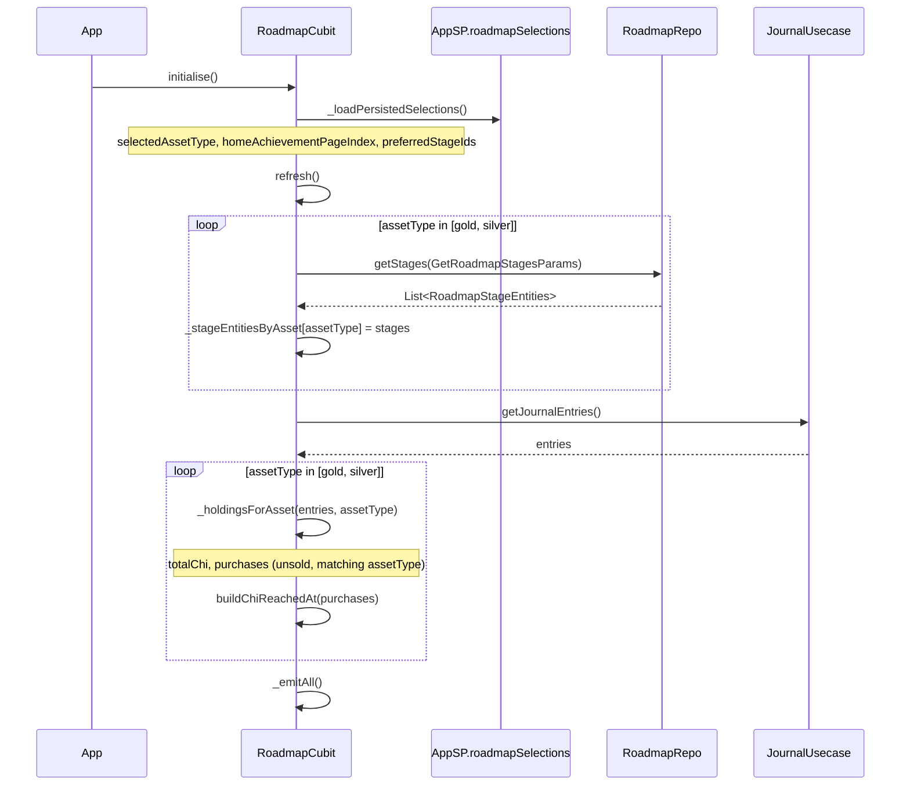
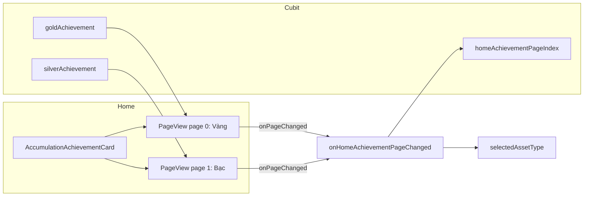

# Lộ trình tích sản Vàng / Bạc

Tài liệu mô tả thay đổi tách lộ trình theo loại tài sản (vàng, bạc), carousel “Thành tựu tích sản” trên Home, và luồng xử lý dữ liệu end-to-end.

---

## Tổng quan

| Khía cạnh | Trước | Sau |
|-----------|-------|-----|
| Lộ trình | Chỉ vàng | Vàng + Bạc (tab riêng) |
| Đơn vị nội bộ | Chỉ | Vẫn là **chỉ** cho cả hai |
| Hiển thị UI | Lượng / chỉ | Vàng: lượng/chỉ · Bạc: lượng/kg (tự chọn kg khi ≥ 1 kg) |
| Home card | Một card vàng | `PageView` vuốt Vàng ↔ Bạc |
| Cubit | Một bộ stage | Một `RoadmapCubit`, map theo `assetType` |

---

## Kiến trúc tầng

```
┌─────────────────────────────────────────────────────────────────┐
│  UI                                                             │
│  Home: AccumulationAchievementCard (PageView)                   │
│  Tab Lộ trình: RoadmapView + MarketWorldAssetTabs               │
└───────────────────────────┬─────────────────────────────────────┘
                            │ BlocBuilder / callbacks
┌───────────────────────────▼─────────────────────────────────────┐
│  RoadmapCubit                                                   │
│  - _stageEntitiesByAsset, _currentMassChiByAsset                │
│  - _massReachedAtByAsset, _preferredStageIdByAsset              │
│  - goldAchievement / silverAchievement snapshots                │
└───────────────┬─────────────────────────────┬───────────────────┘
                │                             │
┌───────────────▼──────────────┐  ┌───────────▼───────────────────┐
│  GetRoadmapStagesUsecase     │  │  GetJournalEntriesUsecase       │
│  GetRoadmapStagesParams      │  │  (holdings theo assetType)      │
└───────────────┬──────────────┘  └─────────────────────────────────┘
                │
┌───────────────▼──────────────┐
│  RoadmapRepoImpl             │
│  RoadmapLocalDataSource      │
│  _goldStages / _silverStages │
└──────────────────────────────┘
```

---

## File thay đổi / thêm mới

### Domain & data

| File | Vai trò |
|------|---------|
| `lib/enums/roadmap_asset_type_enum.dart` | Enum `gold` / `silver` + label hiển thị |
| `lib/domain/entities/roadmap/get_roadmap_stages_params.dart` | Tham số `assetType` khi lấy stages |
| `lib/domain/entities/roadmap/roadmap_stage_entities.dart` | Thêm field `assetType` |
| `lib/data/models/local/roadmap/roadmap_stage_local_model.dart` | Thêm field `assetType` |
| `lib/data/data_source/local/roadmap/roadmap_local_data_source.dart` | `_goldStages` (7 mốc) + `_silverStages` (7 mốc) |
| `lib/data/repositories/roadmap/roadmap_repo_impl.dart` | Truyền `assetType` xuống local |
| `lib/domain/repositories/roadmap/roadmap_repo.dart` | Signature `getStages([params])` |
| `lib/domain/usecases/roadmap/roadmap_usecases.dart` | `GetRoadmapStagesUsecase` nhận params |

### Presentation

| File | Vai trò |
|------|---------|
| `lib/models/roadmap_achievement_snapshot.dart` | DTO tóm tắt cho Home carousel |
| `lib/models/roadmap_model.dart` | `RoadmapStageModel.assetType` |
| `lib/presentations/mappers/roadmap_presentation_mapper.dart` | `formatMass(chi, assetType)`, milestone theo asset |
| `lib/presentations/mappers/mass_presentation_formatter.dart` | Format bạc: lượng hoặc kg |
| `lib/presentations/modules/roadmap/cubit/roadmap_cubit.dart` | Logic dual-asset, persistence |
| `lib/presentations/modules/roadmap/cubit/roadmap_state.dart` | State mở rộng |
| `lib/presentations/modules/roadmap/components/roadmap_view.dart` | Tab Vàng/Bạc, gradient bạc |
| `lib/presentations/modules/home/components/accumulation_achievement_card.dart` | PageView + indicator |
| `lib/presentations/modules/home/components/home_overview_view.dart` | Wire achievement props |
| `lib/presentations/modules/home/components/home_view.dart` | `openRoadmapTab` + chuyển tab 3 |
| `core/lib/storage/app_shared_preferences.dart` | Key `roadmapSelections` |

---

## Đơn vị nội bộ & ngưỡng mốc

Mọi tính toán tiến độ dùng **chỉ** (`chi`) làm đơn vị chuẩn:

```dart
// lib/enums/journal_unit_enum.dart
static const chiPerLuong = 10.0;
static const luongPerKg = 26.666;
static const chiPerKg = luongPerKg * chiPerLuong; // ≈ 266.66
```

### Lộ trình Vàng (`assetType: gold`)

| Stage | ID | Ngưỡng (chỉ) |
|-------|-----|--------------|
| Khởi hành | `khoi-hanh` | 5 |
| Tích lũy | `tich-luy` | 15 |
| Vững vàng | `vung-vang` | 30 |
| Đủ đầy | `du-day` | 50 |
| Sung túc | `sung-tuc` | 100 |
| An tâm | `an-tam` | 200 |
| Đỉnh cao | `dinh-cao` | 500 |

### Lộ trình Bạc (`assetType: silver`)

| Stage | ID | Ngưỡng (chỉ) | Ý nghĩa hiển thị |
|-------|-----|--------------|------------------|
| Khởi đầu | `bac-khoi-dau` | 10 | 1 lượng |
| Tích lũy | `bac-tich-luy` | 266.66 | 1 kg |
| Vững chắc | `bac-vung-chac` | 533.32 | 2 kg |
| Đủ đầy | `bac-du-day` | 1333.3 | 5 kg |
| Sung túc | `bac-sung-tuc` | 2666.6 | 10 kg |
| An tâm | `bac-an-tam` | 5333.2 | 20 kg |
| Đỉnh cao | `bac-dinh-cao` | 13333 | 50 kg |

Hiển thị bạc qua `MassPresentationFormatter.formatSilverFromChi`: dùng **lượng** khi &lt; 1 kg, tự chuyển **kg** khi `luong >= 26.666`.

---

## Luồng khởi tạo (`RoadmapCubit.initialise`)



### `_holdingsForAsset`

1. Lọc journal: `!entry.isSold` và `entry.assetType == assetType`.
2. Quy đổi khối lượng → chỉ qua `JournalPresentationMapper.toChi(entry)`.
3. Cộng `totalChi`, thu thập `(chi, purchasedAt)` cho milestone timeline.

---

## Luồng emit state (`_emitAll`)

Mỗi lần dữ liệu hoặc lựa chọn thay đổi:

1. **`_buildAchievementSnapshot('gold')`** và **`('silver')`** — dùng cho Home carousel.
2. **`_buildTabState(assetType: selectedAssetType)`** — stages, milestones, progress cho tab Lộ trình đang chọn.

`RoadmapState` gồm:

- `selectedAssetType`, `homeAchievementPageIndex`
- `goldAchievement`, `silverAchievement`
- `stages`, `milestones`, `currentStageId`, `activeStageId`, `currentMassChi` (theo tab đang chọn)

### Phân biệt `currentStageId` vs `activeStageId`

| Field | Ý nghĩa |
|-------|---------|
| `activeStageId` | Stage thực tế theo khối lượng hiện tại (`resolveActiveStageId`) |
| `currentStageId` | Stage user đang xem (có thể chọn khác qua sheet danh sách) |

`preferredStageIdByAsset` lưu lựa chọn xem theo từng asset; mặc định = `activeStageId`.

---

## Luồng Home — carousel “Thành tựu tích sản”



### Hành vi UI

- **Trang trống** (`currentMassChi <= 0`): empty state + nút “Xem lộ trình”.
- **Có dữ liệu**: tên stage, khối lượng hiện tại, “Còn X để đạt mốc tiếp theo”, progress bar, `completed/total mốc`.
- **Indicator** “Vàng” / “Bạc” góc phải tiêu đề.
- Progress bar bạc dùng `AppColor.silverLinearGradient`.

### Vuốt carousel → đồng bộ tab Lộ trình

`onHomeAchievementPageChanged(index)`:

```dart
index == 0 → selectedAssetType = 'gold'
index == 1 → selectedAssetType = 'silver'
homeAchievementPageIndex = index
→ _persistSelections() → _emitAll()
```

Khi user mở tab Lộ trình (index 3), tab Vàng/Bạc đã khớp với trang carousel cuối cùng.

### Nút “Xem lộ trình”

`home_view.dart`:

```dart
onViewRoadmapTap: (assetType) {
  roadmapCubit.openRoadmapTab(assetType: assetType);
  homeCubit.onTabSelected(3);
}
```

`openRoadmapTab` cập nhật `selectedAssetType` + `homeAchievementPageIndex`, persist, emit lại.

---

## Luồng tab Lộ trình (`RoadmapView`)

1. `MarketWorldAssetTabs` — chọn Vàng/Bạc → `onAssetTypeSelected(RoadmapAssetType)`.
2. `_StageHeaderCard` — tiêu đề stage, `progressLabel`, menu mở sheet chọn stage.
3. `ListView` milestones — timeline trạng thái `completed` / `current` / `upcoming`.

Header bạc: gradient `silverLinearGradient`, chữ tương phản tốt hơn trên nền bạc.

`progressLabel` ví dụ:

```
"1 lượng / 3 lượng"        // vàng
"500 g / 1 kg"              // bạc (format qua MassPresentationFormatter)
```

---

## Snapshot thành tựu (`RoadmapAchievementSnapshot`)

| Field | Mô tả |
|-------|--------|
| `assetType` | `gold` \| `silver` |
| `currentMassChi` | Tổng chỉ đang nắm giữ |
| `stageTitle`, `stageIconPath` | Stage active theo khối lượng |
| `completedMilestones`, `totalMilestones` | Trong band stage active |
| `remainingMassChi` | Chỉ còn thiếu tới milestone `current`; `null` nếu hết mốc trong band |

Logic `remainingMassChi`: lấy milestone đầu tiên có `status == current`, tính `thresholdChi - currentMassChi`, clamp ≥ 0.

---

## Persistence (`AppSP.roadmapSelections`)

Key: `roadmap_selections` (`core/lib/storage/app_shared_preferences.dart`)

```json
{
  "selectedAssetType": "gold",
  "homeAchievementPageIndex": 0,
  "preferredStageIds": {
    "gold": "tich-luy",
    "silver": "bac-khoi-dau"
  }
}
```

Ghi khi:

- Đổi tab Vàng/Bạc trên Lộ trình (`onAssetTypeSelected`)
- Vuốt carousel Home (`onHomeAchievementPageChanged`)
- Chọn stage từ sheet (`selectStage`)
- Mở Lộ trình từ Home (`openRoadmapTab`)

Đọc trong `_loadPersistedSelections()` trước `refresh()` lần đầu.

---

## Refresh khi journal thay đổi

Home gọi `roadmapCubit.refresh()` sau khi cập nhật nhật ký mua/bán (giữ nguyên pattern cũ). `refresh()`:

1. Tải lại stages vàng + bạc từ local.
2. Tính lại holdings từ journal.
3. `_emitAll()` — cập nhật cả carousel và tab Lộ trình.

---

## Mapper & milestone

`RoadmapPresentationMapper.toMilestonesForStage`:

- Band milestone: từ `prevThreshold` đến `thresholdChi` của stage đang focus.
- Sinh các ngưỡng chỉ integer (có bước nhảy khi band lớn).
- Gắn `status`: completed / current / upcoming theo `currentChi`.
- Label khối lượng qua `formatMass(..., assetType)`.

`buildChiReachedAt`: theo dõi từng chỉ tích lũy theo thứ tự mua để hiển thị ngày đạt mốc trên timeline.

---

## Sơ đồ tương tác người dùng

```
[Home - Thành tựu tích sản]
        │
        ├─ Vuốt trái/phải ──► đổi Vàng/Bạc + lưu SP + sync tab Lộ trình
        │
        └─ "Xem lộ trình" ──► openRoadmapTab(assetType) + chuyển BottomNav tab 3

[Tab Lộ trình]
        │
        ├─ Tab Vàng/Bạc ──► onAssetTypeSelected + persist
        │
        ├─ Menu stage ──► RoadmapListSheet → selectStage (theo asset hiện tại)
        │
        └─ Timeline milestones (format theo asset)
```

---

## Ghi chú triển khai

1. **Một Cubit, hai asset** — tránh duplicate logic; state tab hiện tại derive từ `selectedAssetType`.
2. **Không đổi schema SQLite roadmap** — stages bạc hard-code trong local data source (giống vàng).
3. **`currentChi` getter** — alias backward-compatible trên `RoadmapState`.
4. **Chiều cao carousel** — `220.h` trong `AccumulationAchievementCard`; có thể tinh chỉnh nếu clip nút trên màn nhỏ.

---

## Kiểm thử gợi ý

- [ ] User chỉ có vàng: trang Bạc empty state, trang Vàng có progress.
- [ ] User chỉ có bạc: ngược lại.
- [ ] Vuốt Home → mở Lộ trình: đúng tab Vàng/Bạc.
- [ ] Chọn stage khác trên vàng, chuyển bạc: mỗi asset giữ `preferredStageId` riêng.
- [ ] Kill app → mở lại: carousel và tab Lộ trình khôi phục từ `roadmapSelections`.
- [ ] Thêm journal entry bạc → `refresh()` cập nhật milestone và remaining text (kg/lượng).

---

*Tài liệu tạo: 2026-08-29 — feature lộ trình bạc + carousel Home.*
